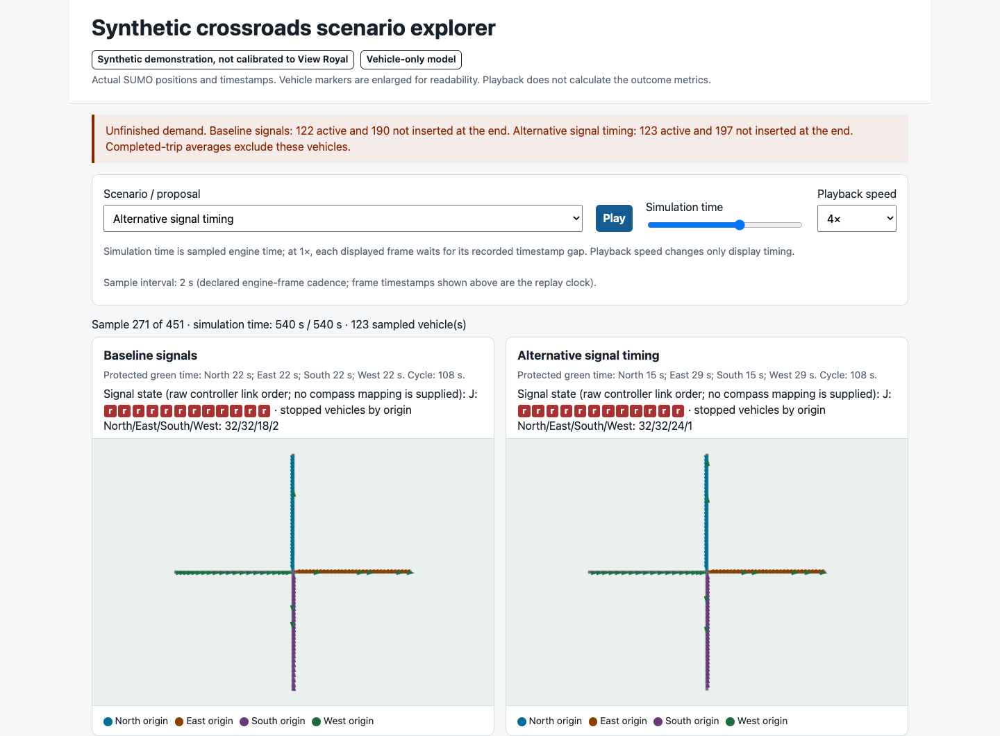

# View Royal Traffic Lab

[](https://github.com/ozone4/view-royal-traffic-lab/actions/workflows/ci.yml)
[](LICENSE)

A small, inspectable traffic-simulation sandbox built on [Eclipse SUMO](https://eclipse.dev/sumo/), with a self-contained browser replay and matched scenario comparisons.

**Experimental and synthetic.** The included intersection is fictional, not a map of View Royal. Demand is synthetic and passenger-vehicle-only. Nothing here is calibrated to local traffic or establishes an engineering or safety conclusion.

**Try it without installing:** download the [offline HTML demo](https://github.com/ozone4/view-royal-traffic-lab/releases/download/v0.1.0/traffic-lab-demo.html) from the [v0.1.0 preview release](https://github.com/ozone4/view-royal-traffic-lab/releases/tag/v0.1.0), then open the downloaded file in your browser. This is a recorded simulation, not an in-browser scenario editor.



## What it does

- Runs genuine SUMO simulations with baseline signals, alternative green-time allocation, and a deliberately restricted downstream exit.
- Freezes the same arrival requests across variants so timing comparisons use matched demand.
- Accounts for completed, active, never-inserted and removed vehicles, including per-approach results.
- Retains input hashes, engine diagnostics, trip XML and a vehicle ledger locally.
- Exports one offline HTML file with synchronized side-by-side playback, a timeline, scenario selection and provenance.
- Runs repeated-seed, demand, time-step and horizon sensitivity experiments without declaring an automatic winner.

The browser replays sampled engine positions. It does not run SUMO or invent interpolated movements. New scenarios are generated with the Python CLI; there is no graphical road or signal editor yet.

## Quick start

Use a **Linux or macOS source checkout**, Python 3.11 and [uv](https://docs.astral.sh/uv/getting-started/installation/). The pinned dependencies include SUMO 1.28.0; a separate system SUMO installation is not required. Windows execution and wheel-only distribution are not supported by this milestone.

```bash
git clone https://github.com/ozone4/view-royal-traffic-lab.git
cd view-royal-traffic-lab
uv sync --locked --extra test
.venv/bin/python -m pytest -q -W error
.venv/bin/traffic-lab demo --output runs/demo
```

Open `runs/demo/replay.html` in a browser. That generated HTML can be copied to another computer and viewed without Python, SUMO, a server or network access.

## Known macOS startup limitation

During a fresh archived-checkout check, the first direct demo invocation hit the native `netconvert` startup timeout (30 seconds). Following the full README setup/test sequence in that checkout then passed all 137 tests and a three-scenario demo/audit. The cause of the initial delay remains undiagnosed; later success does not establish a fix. No timeout or simulation behavior was changed to obtain that result.

If a native-tool startup times out, retain the failed output directory and terminal error. Do not treat partial files as valid results or reuse that output path. Include your OS, architecture, Python/SUMO versions and redacted diagnostics when reporting it. The offline downloadable replay is unaffected because it does not start native tools.

## Generate and inspect runs

```bash
# One scenario, using a new output directory
.venv/bin/traffic-lab run --variant rebalanced --seed 42 --demand-scale 1 --output runs/one-run

# Five seeds, three demand levels, all variants, sensitivity checks and a repeat
.venv/bin/traffic-lab study --output runs/study

# Export an existing run or matched bundle without running physics again
.venv/bin/traffic-lab export --run runs/one-run --output runs/one-run/replay.html
.venv/bin/traffic-lab export runs/demo/bundle.json --output runs/copy.html

# Reconcile the serialized replay artifact
.venv/bin/python scripts/audit_artifacts.py runs/demo/bundle.json
```

Output paths must be new. Existing run directories and HTML files are not overwritten. `--out` and `--scale` are compatibility aliases for `--output` and `--demand-scale`.

Edit a copy of `scenarios/synthetic-crossroads/scenario.json` and supply `--scenario path/to/copy.json` to run supported demand and timing changes. The fixed 250-metre approaches, legal turns, supported nonconflicting signal sequence, synthetic evidence labels and finite timing are validated. Unsupported geometry or modes are rejected rather than silently ignored.

## Read results carefully

- **Requested = completed + active + not inserted + removed.** All categories remain visible.
- Completed-trip time-loss and duration means exclude unfinished trips. Lower means with fewer completed trips are not necessarily an improvement.
- Departure delay includes all actual insertions. Never-inserted requests retain censored waiting time in the ledger.
- Maximum stopped vehicles is sampled at every engine step. It is not queue length in metres or HCM control delay.
- Collisions, teleports, unexpected removals and unassessed engine/compiler warnings invalidate comparisons. Unfinished-demand notices alone are informational.
- Seed ranges are descriptive, not confidence intervals. Cross-horizon and cross-step runs are separate sensitivity checks.
- A plausible animation, deterministic repeat and passing software tests do not establish calibration, numerical convergence or safety.

The pre-publication study completed 52 simulations and reconciled 34,320 requested vehicle records. It did not establish an overall improvement from the alternative timing. Restricting the exit reduced completed trips, and time-step/horizon sensitivity was material. See [validation and limitations](docs/validation.md).

## Browser acceptance checks

Node.js 22 or newer is needed only for development/browser QA:

```bash
npm ci --ignore-scripts
npx playwright install chromium webkit
# On Linux, Playwright may also require system libraries; CI uses --with-deps.
WEBKIT_EXECUTABLE="$(node -p "require('playwright').webkit.executablePath()")"   npm run verify:browser -- runs/demo/replay.html runs/browser-qa
```

This checks desktop and mobile-sized Chromium plus mobile-sized WebKit, controls, displayed accounting, layout, browser errors and external requests. It does not constitute physical-device testing. Omitting `WEBKIT_EXECUTABLE` runs only Chromium. Screenshots and receipts stay under ignored `runs/`.

## Project layout

- `src/traffic_lab/`: validation, frozen demand, network compilation, runner, comparison guards and export.
- `viewer/replay.html`: offline viewer template.
- `scenarios/`: fictional example inputs.
- `tests/`: unit, failure-path, accounting, model and live-engine acceptance tests.
- `scripts/`: serialized-artifact audit and browser acceptance checks.

See [architecture](docs/architecture.md) and [contributing](CONTRIBUTING.md). Please do not submit credentials, footage or private observations in issues or pull requests.

## Licence and scope

Original project code and documentation are [MIT licensed](LICENSE). SUMO, TraCI, sumolib, Playwright and other dependencies retain their own licences; see [third-party notices](THIRD_PARTY_NOTICES.md). No upstream source snapshots, simulator binaries, map datasets or private research archive are vendored here.

This milestone has no walking/cycling/transit model, camera integration, hosted service or city-wide model. A real local site needs checked geometry/control, observations, calibration and independent validation before making local claims.
